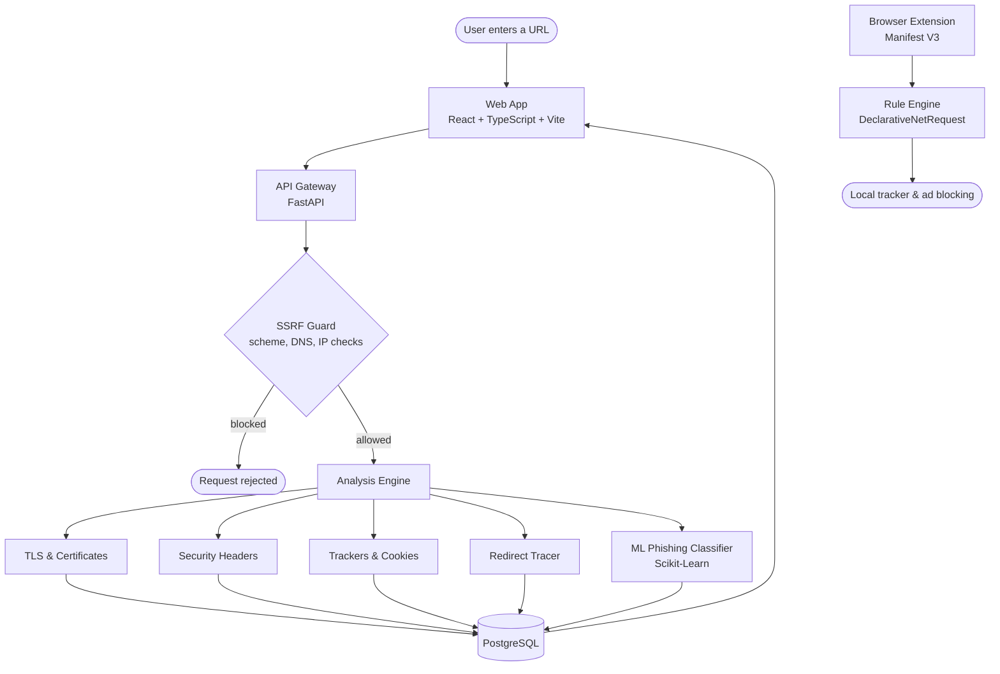

<div align="center">

# 🛡️ RevShield

### Understand what happens behind every website.

**Free, transparent, open-source website security, privacy, tracker and phishing analysis, with continuous local browser protection.**

*See the site. See the risk. Keep your data on your device.*

<br>


<br>

[Overview](#-what-is-revshield) • [Features](#-features) • [Architecture](#%EF%B8%8F-architecture) • [Tech Stack](#-tech-stack) • [Quick Start](#-quick-start) • [Security Design](#%EF%B8%8F-security-design) • [Testing](#-testing) • [License](#-license)

</div>

---

## 🧭 What Is RevShield?

**RevShield** is an open-source platform that shows you how a website really behaves: how it secures your connection, what it tracks, which cookies it sets, where it redirects you, and whether the URL looks like phishing.

Paste any URL and get a clear, explained audit. Install the companion browser extension and get continuous protection that runs **entirely on your device**.

No account. No sign-up wall. No browsing history leaves your machine.

> 💡 **Philosophy:** security and privacy tools should explain themselves. Every finding in RevShield comes with a reason, an impact rating, and a plain-language explanation.

---

## ✨ Features

| | Capability | What you get |
|---|---|---|
| 🔐 | **Transport Security & TLS** | Certificate chain validity, expiration, protocol version and cipher suites. |
| 🧱 | **Security Header Audit** | In-depth analysis of `Content-Security-Policy`, `HSTS`, `X-Frame-Options`, `X-Content-Type-Options`, `Referrer-Policy` and `Permissions-Policy`, with educational explanations and impact ratings. |
| 👁️ | **Privacy & Trackers** | Detects tracking scripts, advertising networks, session replay tools and canvas fingerprinting vectors. |
| 🍪 | **Cookie & Storage Analysis** | First-party vs. third-party classification and `Secure` / `HttpOnly` / `SameSite` compliance, **without ever exposing cookie values**. |
| 🔀 | **Redirect Tracing** | Multi-hop HTTP status tracking and protocol downgrade detection. |
| 🤖 | **ML Phishing Detection** | Interpretable lexical and structural classification with transparent, per-factor attribution. No black box. |
| 🧩 | **Local Browser Extension** | Manifest V3 extension that blocks trackers and ads using native `DeclarativeNetRequest` rules. Nothing is transmitted. |
| 🆓 | **Free & Open** | MIT licensed. No account required. |

---

## 🏗️ Architecture



### Repository Layout

```
RevShield/
├── apps/
│   ├── web/               # React + TypeScript + Vite + Tailwind CSS frontend
│   ├── api/               # FastAPI + SQLAlchemy + Celery + Scikit-Learn backend
│   └── extension/         # Manifest V3 browser extension (DeclarativeNetRequest)
├── packages/
│   ├── shared-types/      # TypeScript interfaces shared by web and extension
│   ├── shared-utils/      # URL normalization, risk tiering, entropy calculation
│   └── rule-engine/       # Tracker signatures and DeclarativeNetRequest rule compiler
└── docker/                # Multi-container Docker Compose configuration
```

---

## 🧰 Tech Stack

| Layer | Technology |
|---|---|
| **Frontend** | React, TypeScript, Vite, Tailwind CSS |
| **Backend** | FastAPI, SQLAlchemy, Celery |
| **Machine Learning** | Scikit-Learn |
| **Data** | PostgreSQL, Redis |
| **Extension** | Manifest V3, DeclarativeNetRequest |
| **Tooling** | npm workspaces, Docker Compose, pytest |

---

## 🚀 Quick Start

### Prerequisites

- Node.js 18+ and npm
- Python 3.10+
- *(Optional)* Docker and Docker Compose

### 1. Backend API & Analysis Engine

```bash
cd apps/api
pip install -r requirements.txt
uvicorn app.main:app --reload --port 8000
```

Interactive API docs: <http://localhost:8000/docs>

### 2. Frontend Web App

```bash
npm install
npm run dev:web
```

Web app: <http://localhost:5173>

### 3. Browser Extension

```bash
npm run build:extension
```

Load it in Chrome, Brave, Edge or Arc:

1. Open `chrome://extensions`
2. Enable **Developer mode** (top right)
3. Click **Load unpacked** and select `apps/extension/dist`

### 🐳 Docker (Full Stack)

Launches PostgreSQL, Redis, the API and the web app:

```bash
docker-compose up --build
```

---

## 🛡️ Security Design

RevShield fetches arbitrary, user-supplied URLs, so the scanner itself is hardened against **SSRF**:

| Control | Behavior |
|---|---|
| **Scheme allowlist** | Only `http://` and `https://` are accepted. |
| **DNS & IP validation** | DNS is resolved *before* dispatch. IPv4/IPv6 loopback (`127.0.0.0/8`, `::1`), private ranges (`10.0.0.0/8`, `172.16.0.0/12`, `192.168.0.0/16`), link-local and cloud metadata (`169.254.169.254`), multicast and internal hostnames are blocked. |
| **Execution limits** | 5 MB response cap, 8-second connect/read timeouts, maximum 5 redirects. |

### Privacy Principles

- 🔒 Cookie **values are never read or displayed**, only their attributes.
- 🏠 The extension blocks locally and **never transmits browsing history**.
- 🚫 No accounts, no tracking of the people using RevShield.
- 🧠 Phishing verdicts are explainable: every score lists the factors behind it.

---

## 🧪 Testing

```bash
cd apps/api
pytest
```

---

## 🤝 Contributing

Contributions, bug reports and tracker-signature additions are welcome.

1. Fork the repository
2. Create a feature branch: `git checkout -b feature/your-feature`
3. Commit your changes and run the tests
4. Open a pull request describing what changed and why

---

## 📄 License

RevShield is released under the [MIT License](LICENSE).

<div align="center">

<br>

**Built to make the invisible parts of the web visible.**

</div>
